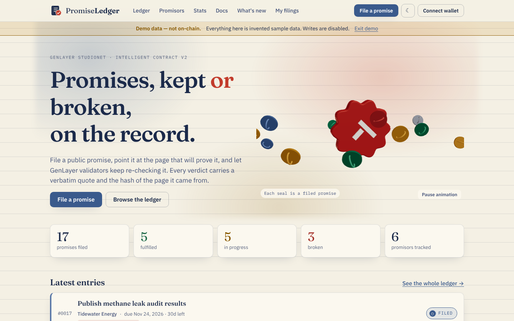

# PromiseLedger v2

A register of public promises, judged by [GenLayer](https://genlayer.com) validators against an evidence page. File a promise, point it at the page that will prove it, and let validators keep re-checking. Every verdict carries a **verbatim quote** and the **hash of the page** it came from. **No quote, no verdict.**



- Contract: [`contracts/promise_ledger.py`](contracts/promise_ledger.py) (Intelligent Contract, GenLayer Studionet)
- App: React + TypeScript + Vite, talks to the contract directly through `genlayer-js` (no backend)
- What changed since v1: [CHANGELOG.md](CHANGELOG.md) · milestone text: [docs/MILESTONE.md](docs/MILESTONE.md)

## Quick start

```bash
npm install
npm run dev            # open the printed URL; add ?demo=1 to see sample data without a deployment
```

Deploy your own v2 contract and point the app at it:

```bash
npm run deploy                         # prints the address (uses a funded throw-away key)
echo "VITE_CONTRACT_ADDRESS=0x..." > .env   # optional: the app already points at the v2 deployment 0x139A49E5fa487483D09F3bF6F1d029E2eE6a9B43
```

Studionet has no external faucet: fund the wallet you connect from [studio.genlayer.com](https://studio.genlayer.com) (account selector, 💧 button).

## How a verdict is made
1. Leader fetches the evidence page → whitespace-normalised, truncated snapshot.
2. Model returns `{status, summary, citation}`; the quote must be verbatim in the snapshot.
3. Validators re-fetch and require: same snapshot hash, the leader's quote verbatim in *their* snapshot, and the same verdict from their own model.
4. The contract then applies deterministic rules: no quote → UNVERIFIABLE; past the deadline and not fulfilled → BROKEN; fulfilled after the deadline → *kept late*.

Details: [docs/ARCHITECTURE.md](docs/ARCHITECTURE.md) · threats and limits: [docs/SECURITY.md](docs/SECURITY.md).

## Contract API (v2)
Writes: `register_promise(title, description, promisor, evidence_url, deadline_at)`, `verify_promise(id)`, `dispute_report(report_id)`, `update_evidence_url(id, url)` (submitter only, only after three failed checks).
Reads: `get_version`, `get_limits`, `get_stats`, `get_promise`, `list_promises`, `get_report`, `get_report_snapshot`, `list_promise_reports`, `get_evidence_revisions`, `list_submitter_promises`, `get_promisor`, `list_promisors`, `list_promisor_promises`.

## Pages
`/` home with 3D hero · `/ledger` · `/promise/:id` case file · `/file` · `/promisors` and `/promisors/:key` track records · `/me` · `/stats` · `/docs` · `/about`. Light/dark theme, reduced-motion and no-WebGL fallbacks.

## Tests

```bash
pip install -r requirements-dev.txt   # once; the first run downloads the GenVM SDK (~200 MB)
npm run test:all                      # 160 frontend + 195 contract tests
npm run mutation                      # 31 injected bugs must all be caught
npm run e2e                           # live Studionet end-to-end + report (see docs/TESTING.md)
```

Open the repo in a GitHub Codespace and everything is installed for you (`.devcontainer/`). The live run writes `reports/e2e-latest.md`, ready to commit.

## Project layout
```
contracts/promise_ledger.py   the Intelligent Contract
src/                          app (lib, hooks, components, pages)
tests/contract/               direct-mode contract tests (normal, adversarial, consensus, invariants)
tests/fixtures/               shared test vectors
e2e/                          live Studionet scripts (deploy, end-to-end) and evidence fixtures
scripts/mutation_check.py     proves the tests catch real bugs
docs/                         architecture, security, testing, performance, screenshots
reports/                      generated end-to-end reports
```

## Deploying the site
The repository is connected directly to Cloudflare Pages (Git integration), so every push to `main` builds and publishes the site; there is no GitHub Actions workflow for it. Settings in Cloudflare Pages:

| Setting | Value |
|---|---|
| Build command | `npm run build` |
| Build output directory | `dist` |
| Node version | 20 or newer (`NODE_VERSION` variable if the default is older) |
| `VITE_CONTRACT_ADDRESS` | optional; the build already points at the v2 deployment `0x139A49E5fa487483D09F3bF6F1d029E2eE6a9B43` |

`wrangler.toml` pins the project name and output directory. `public/_redirects` serves `index.html` for every path, which the client-side router needs (refreshing `/promise/3` would 404 without it). Run `npm run test:all` locally or in a Codespace before pushing, since nothing runs the tests automatically.

> Studionet is a shared, hosted simulator, not a persistent testnet. State can be reset without notice.

Author: [@amirhp771](https://x.com/amirhp771)
